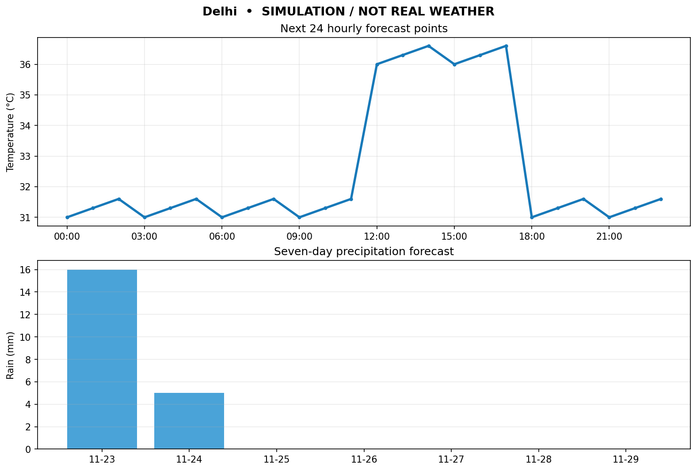

# ⛅ Weather Forecast & Alert Application (WeatherWatch)

> **Portfolio-ready student Python project** • Offline demo • Live weather forecasts • Rule-based alerts • Streamlit dashboard • FastAPI service • SQLite caching • CSV/PNG/JSON exports • Optional Telegram notifications



**Important:** The included sample weather values are **simulated, not observed**. All automatic risk messages are **custom educational thresholds, not official public safety alerts**. Live mode uses Open-Meteo forecast models (not a government warning feed). For safety-critical decisions, consult official local weather agencies.

## 1. What is this application?

**Simple:** Enter a city. The application shows weather, the upcoming forecast, and messages like "Rain likely," "High temperature," and "Strong wind." You can save the results as files. In **Offline simulation**, the weather is made up so students can test everything without internet or an API key.

**Technical:** A Python ingestion adapter calls a geocoding API and a weather JSON endpoint; a normalizer converts parallel arrays into rows; a rules engine scans relevant time windows; SQLite caches results; a Streamlit dashboard displays charts; FastAPI exposes endpoints; a reporting module exports CSV/JSON/TXT/PNG; an optional monitor checks cities at intervals and sends deduplicated Telegram alerts when credentials are configured.

**Problems solved:** Travellers can plan trips, farmers can time operations, logistics teams can anticipate delays, event planners can assess outdoor conditions, and analysts can explore forecast trends. Predictions and modelled risk signals must not be mistaken for certainty.

### Data flow

```text
City entered by user
        |
        v
 [Live] Open-Meteo geocoding -> Forecast API -> Optional AQI API
             OR
 [Offline] Invented weather scenario (no API needed)
        |
        v
 JSON parsing and standard names / units (°C, %, km/h, mm)
        |
        +----> SQLite cache and updated timestamps
        |
        v
 Alert rules: rain, heat, humidity, wind, UV, thunderstorm, AQI
        |
        +----> FastAPI endpoints /weather /alerts /forecast/...
        +----> Streamlit dashboard, map, charts, download buttons
        +----> CSV, JSON, PNG chart, text report
        +----> Optional Telegram monitor (explicitly configured)
```

## 2. Choose a tech stack

| Option | Libraries | Difficulty | Output |
|---|---|---|---|
| A - Easy | Python, requests, JSON, CSV | Beginner | Text weather summary and CSV |
| **B - Chosen** | Python, requests, pandas, matplotlib, Streamlit, SQLite, FastAPI | Intermediate | Dashboard, API, charts, alerts, reports |
| C - Advanced | Python/FastAPI, Next.js, Redis, Docker, worker queue, production monitoring | Advanced | Scalable multiuser web application |

**B is recommended for a student portfolio:** an approachable runnable application plus separate backend API code for interviews. Option C can be a future improvement.

## 3. Main features

- 🌐 **Live forecast model** by chosen city using Open-Meteo geocoding and forecast APIs, without an API key for non-commercial student use.
- 🧪 **Offline simulation** generates a labelled scenario, works without internet after dependencies are installed, and exercises alert rules.
- ⚠️ **Alerts:** rain in 12 hours (default probability ≥60% or precipitation ≥2 mm/hour), heat (daily maximum ≥40 °C within two days), current humidity ≥85%, gusts ≥54 km/h in next 24 hours, today's UV ≥8, storm code in next 24 hours, and modelled US AQI ≥151 where available.
- 📊 Charts, seven-day table, basic location map when coordinates are known.
- 💾 Local SQLite caching for live mode (60 minutes), CSV, TXT, JSON and PNG files.
- 📡 **FastAPI** endpoints with interactive Swagger documentation.
- 📱 Optional Telegram notifications with 12-hour cooldown per city and rule.
- ✅ Automated pytest tests, GitHub-ready files, Windows starter scripts.

**API detail:** `weather_code` is a WMO interpretation from forecast data; a severe-weather code in a model is **not** an official issued alert. AQI is best-effort and can be missing.

## 4. Folder structure

```text
Weather-Forecast-Alert-Application/
├── api/                # FastAPI web service
│   └── app.py
├── src/                # Data provider, rules, storage, reports, demo
│   ├── alerts.py
│   ├── demo.py
│   ├── provider.py
│   ├── reports.py
│   ├── service.py
│   ├── storage.py
│   └── notifications.py
├── jobs/monitor.py     # Optional periodic checks and Telegram
├── tests/              # Automated unit/integration tests
├── data/               # Reference/sample input files
├── db/                 # SQLite database created at runtime, not uploaded
├── images/             # Charts and screenshots
├── reports/            # Plain text summary reports
├── outputs/            # CSV and JSON exports
├── docs/               # GitHub guide, phase plan, interview Q&A
├── dashboard.py        # Streamlit web UI
├── main.py             # Terminal application
├── Dockerfile          # Optional API container
├── .env.example        # Safe example of optional Telegram settings
├── .gitignore          # Keeps secrets/local database out of Git
├── requirements.txt    # Runtime dependencies
├── requirements-dev.txt# Extra dependencies for tests
├── START_HERE.txt      # Super easy Windows instructions
├── RUN_APP_WINDOWS.bat # Windows one-click dashboard
├── RUN_DEMO_WINDOWS.bat# Windows one-click simulation
└── RUN_API_WINDOWS.bat # Windows one-click FastAPI
```

## 5. Install (Windows - easy method)

1. Download and **Extract All** the ZIP.
2. Install [Python 3.11 or later](https://www.python.org/downloads/) and select **Add Python to PATH** during installation.
3. Open the extracted folder and double-click **`RUN_APP_WINDOWS.bat`**. It sets up a local Python virtual environment, installs the packages, and opens the dashboard automatically.
4. In your browser open `http://localhost:8501` if it doesn't open automatically.
5. Choose **Offline simulation** and press **Check weather**.
6. Switch to **Live Open-Meteo** for model weather data when connected to the internet.

The first installation needs internet to download Python packages. **A weather API key is not needed.** Keep the black terminal window open while the app runs.

If `python` opens Microsoft Store, first install Python; if aliases still interfere, use the Windows `py` launcher (the starter scripts try it automatically). More troubleshooting is in `START_HERE.txt`.

### Manual installation (Windows Command Prompt)

Open a Command Prompt **inside the extracted folder** by clicking the folder's address bar in File Explorer, typing `cmd`, and pressing Enter. Then:

```bat
py -3 -m venv .venv
.venv\Scripts\activate
python -m pip install -r requirements.txt
python -m streamlit run dashboard.py
```

If `py` isn't recognized but `python` works, use `python -m venv .venv` in the first command.

### macOS / Linux

```bash
python3 -m venv .venv
source .venv/bin/activate
python -m pip install -r requirements.txt
python -m streamlit run dashboard.py
```

Or use `sh RUN_MAC_LINUX.sh`.

## 6. Run each mode

**Dashboard (both modes)**

```bash
python -m streamlit run dashboard.py
```

**CLI simulation:** no weather API needed

```bash
python main.py --mode demo --city Delhi
```

**CLI live forecast:** needs internet

```bash
python main.py --mode live --city Kolkata
```

**Change thresholds:**

```bash
python main.py --mode demo --city Mumbai --rain 75 --heat 42 --humidity 90 --wind 65
```

**FastAPI mode:**

```bash
python -m uvicorn api.app:app --host 127.0.0.1 --port 8000 --reload
```

Then visit **http://127.0.0.1:8000/docs**. Test `GET /weather?city=Delhi&mode=demo`, `GET /alerts`, `GET /forecast/hourly`, `GET /forecast/daily`, `GET /locations`.

**Run the monitor one time:**

```bash
python -m jobs.monitor --mode demo --cities Delhi Kolkata --once
```

**Live monitoring every hour while terminal stays open:**

```bash
python -m jobs.monitor --mode live --cities Delhi Kolkata --interval-minutes 60
```

This is a foreground process, not a hosted background scheduler. Close it or press `Ctrl+C` to stop. Set up your own OS scheduler or deployment if you want unattended checks.

## 7. Optional Telegram notifications

For **in-app alerts**, nothing needs to be set up. For Telegram delivery, create a Telegram bot with BotFather, obtain a chat ID that you control, copy `.env.example` to `.env`, and fill in:

```dotenv
TELEGRAM_BOT_TOKEN=replace_with_your_private_bot_token
TELEGRAM_CHAT_ID=replace_with_your_private_chat_id
```

The monitor sends Telegram messages for **live mode** after you run it. Demo mode will **not** send simulated messages unless you explicitly add `--send-demo`. Each type of alert is sent at most once per city every 12 hours while the local SQLite log exists. No messages are sent unless credentials are configured. **Never commit `.env`** or reveal your token in screenshots.

## 8. Sample result

```text
WEATHER FORECAST & ALERT APPLICATION — Delhi
SOURCE: SIMULATION (NOT REAL WEATHER)
Temperature: 35.5 °C
Humidity: 91%
Wind speed: 15 km/h
US AQI: 175
ALERTS:
[WARNING] Rain likely within 12 hours
[CRITICAL] High temperature expected
[INFO] High humidity
[WARNING] Strong wind gusts possible
[WARNING] High UV exposure
[CRITICAL] Thunderstorms possible
[WARNING] Unhealthy air quality
```

The live forecast will **not necessarily produce these values or alerts**. Values in the sample report are invented for testing. See `reports/`, `outputs/`, and `images/` for ready-made simulated output files.

## 9. Proof of work, screenshots, and tests

See **[6-day build plan](docs/PHASE_PLAN.md)** and **[screenshot checklist](docs/SCREENSHOT_GUIDE.md)**. The PNG included is an automatically generated chart **from simulated weather**, not a screenshot of a live website.

```bash
python -m pip install -r requirements-dev.txt
python -m pytest -q
```

This suite checks rain/heat/wind/humidity/UV/storm/AQI rules, missing values, threshold overrides, SQLite caching, reports, and API routes using offline sample data.

## 10. GitHub upload

Recommended repository name: **`weather-forecast-alert-application`**

**Description:** `Python weather forecast dashboard with Open-Meteo integration, FastAPI, Streamlit, alert rules, offline simulation, SQLite and CSV/PNG reports.`

**Topics/tags:** `python`, `weather-api`, `fastapi`, `streamlit`, `api-integration`, `data-visualization`, `automation`, `sqlite`, `beginner-project`, `portfolio-project`

For beginner instructions using **GitHub Desktop** and more advanced terminal commands, read **[GITHUB_GUIDE.md](docs/GITHUB_GUIDE.md)**.

## 11. How I would describe it in an interview

> I developed a Python weather forecast and alert application using a public API. It retrieves location and forecast data, standardizes the JSON, evaluates configurable alert thresholds, caches results in SQLite, displays charts in Streamlit, serves endpoints through FastAPI, and saves reports. I also implemented offline simulated data and automated tests so the project can be demonstrated reliably without live API access.

See **[10 interview questions and answers](docs/INTERVIEW_QA.md)** for technical and HR preparation.

## 12. Roadmap and limitations

Current scope: local single-machine educational app. Potential enhancements include official agency warnings, location-name disambiguation, SMS/email, multiple data providers, 2FA/login, cloud deployment, weather radar layers, source timestamp validation, and dedicated task queue scheduling. The map shows the city location, not a radar map. Live geocoding selects the first ranked city match; for ambiguous place names use more specific city details.

## Credits and permitted use

- Weather and geocoding: [Open-Meteo API documentation](https://open-meteo.com/en/docs), [geocoding](https://open-meteo.com/en/docs/geocoding-api)
- Air quality where available: [Open-Meteo Air Quality API](https://open-meteo.com/en/docs/air-quality-api) with **CAMS data attribution**.
- Open-Meteo's no-key public endpoint is intended for **non-commercial use** and is subject to current [licensing and rate limits](https://open-meteo.com/en/pricing). Check terms before deploying commercially.
- Charts: Matplotlib and Streamlit; data transformation: Pandas.
